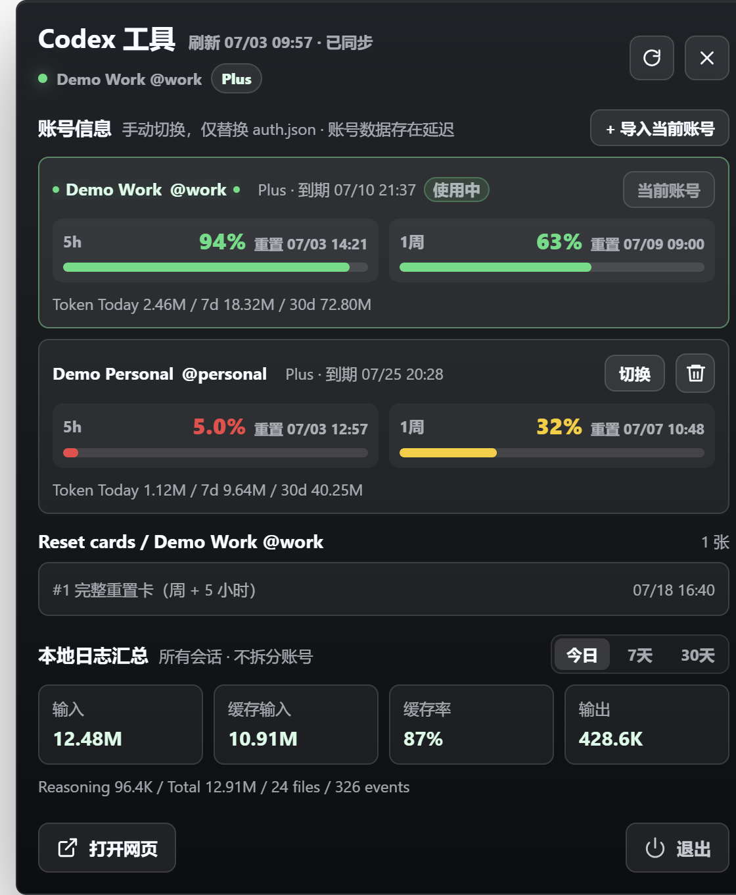
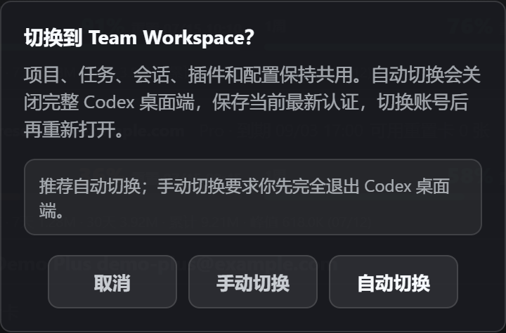
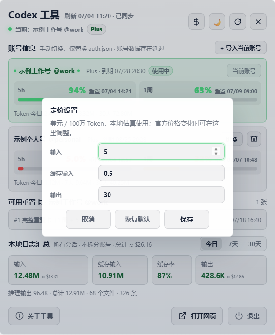
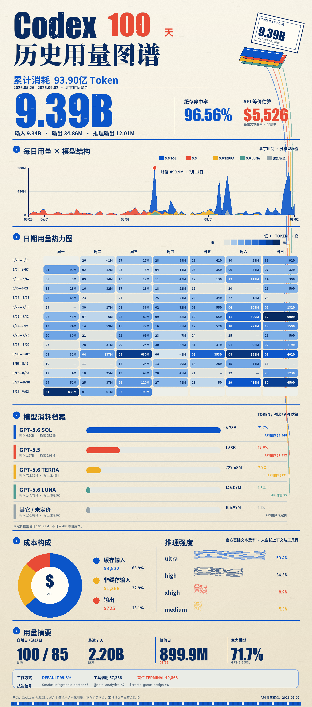

<div align="center">
  <h1>Codex Usage Float</h1>
  <p><strong>Codex桌面版 多账号用量、多账号切换、会员信息、重置卡与本地 Token 日志汇总工具</strong></p>
  <p><sub>作者 @可以叫我才哥</sub></p>
  <p>
    <a href="https://github.com/dxawdc/codex-usage-float/releases/latest"></a>
    <a href="LICENSE"></a>
    
    
  </p>
</div>

当前 GitHub Releases 最新版本为 `v2.2.2`，Windows 便携版 EXE 通过 Release 提供。本版修复大体积日志引起的启动闪退，并支持直接在详情弹窗中使用重置卡。

一个面向 Windows 桌面的轻量 Codex 多账号用量悬浮工具。应用读取本机 Codex 登录状态，按接口实际返回情况展示多个账号的 5 小时和/或 1 周额度、会员信息、重置卡、账号 Token 概览，以及所有本地会话的 Token 分类汇总与费用估算；支持四种悬浮球样式、深色/浅色主题、自动同步模型定价和手动覆盖。

## 下载安装

无需配置 Node.js，直接下载 Windows 便携版 EXE 即可运行：

- **最新 GitHub Release**：[CodexUsageFloat v2.2.2](https://github.com/dxawdc/codex-usage-float/releases/download/v2.2.2/CodexUsageFloat-2.2.2.exe)
- **全部版本**：[GitHub Releases](https://github.com/dxawdc/codex-usage-float/releases)

下载后双击 EXE 即可启动，无需安装。应用目前没有商业代码签名，Windows SmartScreen 可能显示“未知发布者”；请确认下载地址来自本仓库，并按需核对 SHA-256：

| 版本 | 文件 | SHA-256 |
| --- | --- | --- |
| `v2.2.2` | `CodexUsageFloat-2.2.2.exe` | `6D18ED7D8B447001E2B255136407823A8DCDF25D35BE9BFDF33CBDBDFFDFF320` |
| `v2.2.1` | `CodexUsageFloat-2.2.1.exe` | `CFCF7498B7C4242F81D1A1A432A00EDA21775EC246132258C960DE3D4FFDFD9B` |
| `v2.2.0` | `CodexUsageFloat-2.2.0.exe` | `014949722E8FC22A3F4EF396C14C35451E6D948435E23589E23BC154C713F2A7` |
| `v2.1.0` | `CodexUsageFloat-2.1.0.exe` | `AE68249927D262C9A389E14E6E1C4D0192C861A6DE16E8AC8FECCE1F654BD220` |
| `v2.0.3` | `CodexUsageFloat-2.0.3.exe` | `D1F166298819A9B3FC40EF1E6D74A6492971D7E71D1F13AAD9EEFEDBC3CD9FA1` |

PowerShell 校验示例：

```powershell
Get-FileHash .\CodexUsageFloat-2.2.2.exe -Algorithm SHA256
```

## 界面预览

<table>
  <tr>
    <td width="33%" align="center">
      <a href="docs/screenshots/multi-account-dashboard.png">
        
      </a>
      <br />
      <sub>多账号用量看板</sub>
    </td>
    <td width="33%" align="center">
      <a href="docs/screenshots/account-switch-confirm.png">
        
      </a>
      <br />
      <sub>账号切换确认</sub>
    </td>
    <td width="33%" align="center">
      <a href="docs/screenshots/pricing-settings-light.png">
        
      </a>
      <br />
      <sub>浅色主题与定价设置</sub>
    </td>
  </tr>
</table>

截图使用示例账号名称，未包含真实登录凭据。

## Codex 历史用量海报 Skill

仓库附带可分享的 [`codex-usage-history-poster`](skills/codex-usage-history-poster/) Skill。它会读取使用者自己的 Codex 本地 JSONL 日志，统一按北京时间聚合，并生成包含每日分模型趋势、日期热力图、模型 Token/占比/成本、推理强度和工作方式摘要的竖版信息图。

<p align="center">
  <a href="skills/codex-usage-history-poster/assets/example-codex-usage-poster.png">
    
  </a>
</p>

复制 Skill 目录到个人 Codex skills 目录：

```powershell
Copy-Item -Recurse .\skills\codex-usage-history-poster "$env:USERPROFILE\.codex\skills\"
```

随后在 Codex 中调用：

```text
$codex-usage-history-poster 分析我的本地 Codex 历史用量，并生成包含分模型数据和日期热力图的竖版海报。
```

默认分析最近 100 个自然日。生成结果只包含聚合用量和显式 Skill/插件标记，不导出消息正文、工具参数、认证数据或真实会话 ID。成本为官方基础文本费率的 API 等价估算，并非实际账单。

## 主要功能

- **桌面悬浮球**：常驻桌面，显示当前账号会员等级和可用额度窗口；优先显示真实存在的 5 小时窗口，缺失时自动显示 1 周窗口；提供“经典方环、极光玻璃、像素伙伴、机械翻牌”四种样式，均适配深色/浅色主题；刷新后剩余百分比变化会以短动画过渡；拖动时会限制在显示器工作区内，避免移出屏幕后找不到。
- **多账号看板**：同时查看已导入账号的显示昵称、用户名、会员等级、会员到期时间、可用重置卡数量，以及接口实际返回的 5 小时和/或 1 周额度；不存在的额度窗口不会显示；账号超过 3 个时在列表内滚动。
- **可控账号切换**：提供手动切换与自动切换；均只原子替换 `~/.codex/auth.json`，项目、任务、会话、插件和配置继续共用。自动切换会先关闭完整 Codex 桌面应用，保存当前最新认证，再切换并重新启动。工具不修改 `CODEX_HOME` 和 `config.toml`，也不会自动轮换账号。
- **账号 Token 概览**：每个账号展示今日、7 天、30 天、累计与单日峰值（含峰值日期）。数据优先来自账号接口，可能存在同步延迟；接口未提供的字段会显示 `--`。
- **本地日志汇总**：按今日、7 天、30 天和累计切换查看输入、缓存输入、缓存率、输出、推理输出、总计、文件数和 `token_count` 事件数；按模型双列展示用量与费用，并使用独立模型费率估算总费用。
- **重置卡使用**：账号卡片汇总可用数量，详情弹窗显示当前账号的卡片、适用窗口和有效期；点击“使用”，核对账号与卡片后确认提交，成功后刷新额度。已过期或缺少标识的卡片不可使用，同一卡片重试沿用固定请求标识；超过 2 张时列表内部滚动。
- **自适应面板**：面板高度随内容变化，底部操作区保持独立，不与日志信息重叠。
- **设置中心**：支持深色/浅色主题；在统一设置中心的“刷新时间 / 模型定价 / 显示模式 / 悬浮球”左侧 Tab 中调整自动刷新间隔（默认 30 分钟）、各模型输入/缓存输入/输出单价、窗口置顶状态和悬浮球样式。选择样式后立即预览，保存后固定使用。
- **过程反馈**：导入已有账号时明确提示已更新；账号切换展示进行中、成功或失败状态。
- **便携打包**：使用 `electron-builder` 生成 Windows portable EXE，无需安装程序。

## 快速开始

### 环境要求

- Windows 10 或 Windows 11
- Node.js 22.12 或更高版本（仅源码运行与打包需要）
- npm
- 已通过 Codex 登录，且存在 `~/.codex/auth.json`

### 安装与运行

```powershell
git clone https://github.com/dxawdc/codex-usage-float.git
cd codex-usage-float
npm install
npx --no-install install-electron
npm start
```

开发模式与普通启动使用相同入口：

```powershell
npm run dev
```

## 多账号使用

1. 使用 Codex 官方登录流程登录第一个账号。
2. 打开本工具，点击“导入当前账号”。
3. 点击“添加账号”。工具会关闭 Codex、保存第一个账号的最新认证，只移除活动 `auth.json`，再重新打开 Codex。
4. 在重新打开的 Codex 中登录另一个账号。不要使用“退出登录”来添加账号。
5. 回到本工具，点击“导入当前账号”。
6. 后续可在账号卡片中点击“切换”，选择“手动切换”或“自动切换”。

账号以登录令牌中的稳定用户或账号标识去重。重复导入同一账号时会更新已有快照、个人资料和用量，不会新增重复条目。

手动切换要求先完全退出 Codex，再保存当前最新认证并替换活动 `auth.json`，完成后由用户打开 Codex。自动切换会关闭完整桌面端，等待认证落盘，再保存当前账号、替换目标认证并从 Windows 应用入口重新启动。自动启动失败时请手动打开 Codex。如果账号提示 `token_revoked` 或 refresh token 已使用，需要通过“添加账号”流程重新登录一次；旧令牌无法恢复。

所有账号继续使用同一个 `~/.codex`。本工具不会移动或删除项目、任务、会话、SQLite 状态、插件、skills、`config.toml` 或本地日志；只切换 `auth.json`。服务端按账号隔离的云端数据仍由 OpenAI 账号权限决定。

## 在弹窗中使用重置卡

1. 单击悬浮球展开详情，确认当前账号及其重置卡列表。
2. 点击目标卡片右侧的“使用”，在确认框核对账号和卡片名称。
3. 点击“确认使用”。卡片会被消耗，额度按卡片规则重置，此操作不可撤销。
4. 成功后查看刷新的额度与卡片列表。若已提示使用成功但数据暂未刷新，可稍后手动刷新；该卡仍标记为“已使用”。网络异常时可重试同一卡片，请求标识保持不变。

重置卡仅对当前登录账号提交，操作前会重新检查账号身份、卡片状态与有效期。接口不可用或需要重新登录时会提示原因。

## 数据来源与口径

### 账号、会员与额度

应用读取 `~/.codex/auth.json` 获取当前认证上下文，并请求当前账号可访问的 Codex / ChatGPT 数据接口：

- 个人资料：显示昵称和用户名。
- 会员信息：计划等级和会员到期时间。付费账号会在必要时通过 ChatGPT 订阅接口校准真实到期时间，避免过期 JWT 声明继续显示旧日期。
- 额度窗口：按接口实际返回情况展示 5 小时和/或 1 周的剩余百分比与重置时间。
- 重置卡：可用数量、适用窗口和有效期信息。

订阅到期时间探测与普通用量刷新分开节流：本地已有可信未来到期时间且距离到期超过 3 天时不请求订阅接口；3 天内、缺少到期时间或本地日期明显过期时才有资格探测，正常情况下 6 小时内最多探测一次。接口字段可能变化或暂时不可访问。刷新失败时，应用优先保留最近一次成功快照，避免用空响应覆盖有效数据。

### 账号 Token 概览

账号卡片中的今日、7 天、30 天、累计和单日峰值来自账号级统计接口。此口径适合比较不同账号的大致用量，但可能有延迟，也不一定提供输入、输出和缓存输入拆分；累计或峰值字段缺失时不会用本地日志估算值冒充接口数据。

### 本地日志汇总

底部“本地日志汇总”扫描以下目录中的 JSONL 会话文件：

```text
~/.codex/sessions
~/.codex/archived_sessions
```

应用读取 `token_count` 事件，并按累计值差分统计：

| 指标 | 含义 |
| --- | --- |
| 输入 | `input_tokens` |
| 缓存输入 | `cached_input_tokens` |
| 缓存率 | 缓存输入 / 输入；输入为 0 时显示 `--` |
| 输出 | `output_tokens` |
| 推理输出 | `reasoning_output_tokens` |
| 总计 | `total_tokens` |

本地日志汇总固定统计所有会话，不拆分账号。多个账号共用同一个 `~/.codex` 时，本地历史文件通常缺少可靠账号标识，因此不应将这部分数据解释为某个账号的精确账单。

日志采用 256 KB 分块读取，支持超过 2 GB 的文件；超长单行只流式保留统计所需字段，避免图片或工具输出占满内存。后续刷新增量扫描，暂时读取失败时保留已缓存统计，并提示失败文件或无法解析的记录。首次扫描大量历史日志可能需要数十秒。

### 按模型费用估算与自定义定价

本地会话日志会读取同一会话中的 `turn_context.payload.model`，并将后续 `token_count` 增量按模型拆分。日志未提供模型上下文的历史用量会显示为“未识别模型”，可单独配置其兜底单价。

应用启动时及之后每 24 小时尝试同步 [OpenAI 官方定价页](https://developers.openai.com/api/docs/pricing) 的 Standard 短上下文文本费率，并将最近一次成功结果保存在本机。同步失败时继续使用上次成功的价格；离线首次启动时使用内置预设。新模型会随本地日志自动出现在设置中，匹配到官方价格后无需更新应用。若新模型暂无可匹配价格，费用显示 `--`，避免套用其他模型的单价。

“模型定价”Tab 仍可逐个模型修改输入、缓存输入和输出单价；手动价格优先于同步价格，点击“清除手动改价”可恢复自动定价。

费用估算优先使用手动价格，其次使用已同步的官方 Standard 短上下文费率，最后使用内置预设。保存手动价格后会立即重新计算本地汇总中的估算金额。各模型的官方费率可能变动，请以 OpenAI 的 [Codex rate card](https://help.openai.com/en/articles/20001106-codex-rate-card-2) 与 [模型价格页](https://developers.openai.com/api/docs/pricing) 为准：

```text
输入费用 = (输入 - 缓存输入) / 1,000,000 × 当前模型输入单价
         + 缓存输入 / 1,000,000 × 当前模型缓存输入单价
输出费用 = 输出 / 1,000,000 × 当前模型输出单价
总计费用 = 输入费用 + 输出费用
```

推理输出属于输出统计的一部分，不重复计费。该金额仅用于把本地 Token 用量换算成标准 API 价格的近似参考，并非 ChatGPT / Codex 订阅账单。本地汇总缺少可靠的逐请求计费模式和上下文长度，因此不计算长上下文、Fast、Priority、Batch、Flex 或数据区域费率差异。

## 颜色规则

额度颜色按照“剩余百分比”计算，实际存在的 5 小时与 1 周窗口分别着色：

| 剩余量 | 颜色 |
| --- | --- |
| `0% - 10%` | 红色 |
| `11% - 25%` | 橙色 |
| `26% - 50%` | 黄色 |
| `51% - 100%` | 绿色 |

悬浮球优先跟随当前账号真实存在的 5 小时窗口；没有 5 小时时跟随 1 周窗口。四种样式的百分比和外环、点阵、转轴等强调元素统一使用上述颜色规则。

## 本地文件与安全

应用只在当前 Windows 用户目录中读写数据：

```text
~/.codex/auth.json
%APPDATA%/codex-usage-float/accounts.json
%APPDATA%/codex-usage-float/usage-state.json
%APPDATA%/codex-usage-float/config.json
%APPDATA%/codex-usage-float/Local Storage/
```

- `accounts.json` 保存已导入账号的认证快照，以便后续切换；该文件包含敏感登录信息，请勿上传、分享或纳入备份公开范围。
- 自动刷新间隔、窗口置顶状态和悬浮球样式保存在 `config.json`；主题与自定义 Token 单价保存在 Electron 的本地存储目录中。它们都只在当前 Windows 用户下生效，不会上传到远端。
- 账号快照使用 Electron `safeStorage` 通过当前 Windows 用户的系统加密能力保护；密文仍不可分享，复制到其他 Windows 用户或设备后通常无法解密。请只在可信个人设备上使用。
- 应用不会把令牌写入调试日志、README、截图或 Git 仓库。
- 自动切换会在完整 Codex 桌面端退出后保存当前最新 `auth.json`，再通过临时文件原子替换目标认证，降低令牌轮换丢失和写入中断风险。
- “添加账号”只删除活动 `auth.json`，不会删除 `~/.codex` 下的项目、任务、会话或配置状态。

## 操作方式

- 单击或右键悬浮球：展开或收起详情面板。
- 双击悬浮球：立即刷新用量。
- 鼠标滚轮：调整悬浮球大小。
- 刷新按钮：刷新已保存账号、当前账号重置卡和本地日志汇总。
- 重置卡“使用”：核对当前账号和卡片后确认消耗，成功后刷新额度；取消确认不会消耗卡片。
- 设置中心：在“刷新时间”Tab 调整账号自动刷新间隔（5–180 分钟，默认 30 分钟）；在“模型定价”Tab 调整模型费用估算单价；在“显示模式”Tab 开关窗口置顶；在“悬浮球”Tab 选择四种外观之一，选择后实时预览，点击“保存悬浮球”后持久化。
- 添加账号：关闭 Codex、保存当前认证并清除活动 `auth.json`，重新打开后登录新账号。
- 导入当前账号：读取当前 `auth.json` 并保存或更新账号快照。
- 手动切换：要求先完全退出 Codex，再保存当前最新认证并替换目标 `auth.json`，完成后由用户打开 Codex。
- 自动切换：关闭完整 Codex 桌面端、保存当前最新认证、替换目标 `auth.json`，并从 Windows 应用入口重新启动。
- 主题切换：在深色与浅色界面之间切换，设置保存在本机。
- 删除：从工具账号库中移除非当前账号，不会删除 Codex 会话文件。
- 关于工具：打开本项目 GitHub 仓库。
- 打开网页：打开 ChatGPT / Codex 页面。
- 退出：关闭应用。

## 打包 Windows EXE

默认生成 Windows portable EXE：

```powershell
npx --no-install install-electron
npm run build
```

Electron 43.7.9 在首次运行时下载二进制；全新安装依赖后直接打包，需要先执行上面的 `install-electron`，已有二进制时会直接复用。

产物输出到 `dist/`，文件名默认为：

```text
CodexUsageFloat-2.2.2.exe
```

如果 Electron 或 electron-builder 二进制下载较慢，可只为当前 PowerShell 会话设置镜像：

```powershell
$env:ELECTRON_MIRROR = "https://npmmirror.com/mirrors/electron/"
$env:ELECTRON_BUILDER_BINARIES_MIRROR = "https://npmmirror.com/mirrors/electron-builder-binaries/"
npx --no-install install-electron
npm run build
```

`dist/` 默认已加入 `.gitignore`。正式发布的 portable EXE 只有在经过检查并按发布要求确认后才会显式纳入仓库或上传 GitHub Release。

项目维护者进行安全检查、正式打包和 GitHub Release 时，请遵循 [安全发布与 GitHub Release 检查清单](docs/RELEASE_CHECKLIST.md)。

提交前检查与重置卡界面回归：

```powershell
npm run verify
npm run smoke:reset-credit
npm run build:dir
```

重置卡回归使用模拟账号和接口响应，不消耗真实卡片。

## 项目结构

```text
src/main.js              Electron 主进程、数据同步、账号流程和窗口管理
src/lib/                 安全存储、进程管理、并发与 JSON 持久化模块
src/preload.js           安全 IPC 桥接
src/renderer/index.html  悬浮球、详情面板和确认弹窗结构
src/renderer/app.js      前端渲染与交互逻辑
src/renderer/styles.css  UI 样式和自适应布局
build/                   应用图标
docs/screenshots/        README 示例截图
docs/RELEASE_CHECKLIST.md 安全发布与 GitHub Release 检查清单
scripts/                  静态检查、渲染层契约验证与 README 截图生成
test/                     Node.js 单元与流程测试
AGENTS.md                 项目维护与交付规则
```

## 已知限制

- Codex / ChatGPT 内部接口并非稳定公开契约，字段或访问规则变化可能导致部分信息暂时不可用。
- 账号 Token 接口可能延迟，且通常只有总量；输入、输出、缓存输入拆分主要来自本地日志。
- 账号 Token 只统计具有账号 ID、会话证据或额度指纹证据的日志；无法确认归属的事件不会强行计入当前账号。底部本地汇总仍采用所有会话口径。
- 费用按标准 API 基础文本费率估算；同步价格和手动价格都只能作为近似参考，不能替代实际 API 或订阅账单。
- 替换 `auth.json` 不会刷新已运行进程的内存认证状态。手动切换后需要自行重启 Codex；自动切换依赖 Windows 应用入口和当前用户对桌面进程的管理权限，失败时需要手动打开应用。
- EXE 默认未进行代码签名，Windows SmartScreen 可能显示未知发布者提示。

## 版本更新记录

### v2.2.2 - 2026-10-11

- 修复启动时读取超过 2 GB 的会话日志导致进程直接退出的问题；改为 256 KB 分块读取。超长单行流式提取模型、时间与 Token 字段，不再因图片或工具输出过长而整行丢弃；损坏行仍明确提示，暂时读取失败的文件保留缓存统计。
- 弹窗重置卡列表新增“使用”按钮，确认目标账号与卡片后提交；使用前核实卡片状态，成功后刷新额度与卡片列表。
- 同一卡片重试沿用固定请求标识，防止重复点击、超时或重启后重复消耗；缺少卡片标识或已过期的卡片不允许直接使用。
- 重置成功后的刷新故障保留成功结果，卡片标记“已使用”；提交前采用同账号最新认证，避免令牌轮换导致请求失败。
- Electron 更新至 43.7.9，构建工具更新至 26.17.0；下载依赖统一为 `@electron/get@5.1.0` 以移除旧代理依赖链的漏洞，本地开发需要 Node.js 22.12 或更高版本。应用版本仍为 2.2.2。
- 重置卡接口依据本机官方客户端实现核对；回归测试使用模拟响应，不消耗真实卡片。

### v2.2.1 - 2026-09-23

- 自动同步 OpenAI 官方 Standard 短上下文模型定价，支持新模型价格、本地缓存和失败时保留上次成功结果。
- 手动定价继续优先；查不到价格的新模型显示 `--`，避免套用旧模型单价。设置中心增加立即同步和价格来源提示。
- 更新定价解析、缓存和 Electron 界面回归测试，修复 3 项构建依赖安全审计告警。
- 构建 Windows portable EXE `CodexUsageFloat-2.2.1.exe`，SHA-256 为 `CFCF7498B7C4242F81D1A1A432A00EDA21775EC246132258C960DE3D4FFDFD9B`。

### v2.2.0 - 2026-08-21

- 修复额外模型额度被误识别为全局 5 小时额度、导致界面长期显示 100% 的问题；全局额度现在只读取顶层 Codex 聚合额度。
- 额度窗口改为严格按真实时长识别，不再用“最接近窗口”猜测；不存在的 5 小时窗口不会渲染，悬浮球会自动切换为 1 周额度。
- 刷新时整体替换额度窗口快照，清理旧版本遗留的虚假 5 小时缓存，并补充单元测试与 Electron 渲染回归测试。
- 升级至 Electron 43.4.1，并更新间接依赖以清除依赖安全审计告警。
- 构建 Windows portable EXE `CodexUsageFloat-2.2.0.exe`，SHA-256 为 `014949722E8FC22A3F4EF396C14C35451E6D948435E23589E23BC154C713F2A7`。

### v2.1.0 - 2026-07-15

- 设置中心新增“悬浮球”Tab，可在“经典方环、极光玻璃、像素伙伴、机械翻牌”四种样式间实时预览；保存后持久化，关闭未保存设置会恢复原样式。
- 三种新增样式完整适配深色/浅色主题，浅色模式改用更轻的玻璃、雾白和浅灰材质，降低悬浮球底色区域的视觉重量。
- 百分比文字与外环、进度弧、点阵、翻牌转轴等强调元素统一跟随 5 小时剩余额度颜色规则，在绿、黄、橙、红四档间同步变化。
- 补充悬浮球配置、实时预览、保存/撤销、主题适配、颜色联动、紧凑尺寸和渲染层控制台错误检查。
- 构建 Windows portable EXE `CodexUsageFloat-2.1.0.exe`，SHA-256 为 `AE68249927D262C9A389E14E6E1C4D0192C861A6DE16E8AC8FECCE1F654BD220`。

### v2.0.3 - 2026-07-14

相对上个已发布版本 `v2.0.2`，本次更新包括：

- 新增真实订阅到期时间校准：付费账号在缺少到期时间、日期已过期或距离到期 3 天内时，才通过 ChatGPT 订阅接口探测；正常情况下 6 小时内最多探测一次。
- 修复 JWT 中旧的 `chatgpt_subscription_active_until` 导致 Plus 账号继续显示过期日期的问题；已拿到真实未来日期后会优先复用，避免高频请求订阅接口。
- 账号卡片新增可用重置卡数量摘要，便于在多账号看板内直接比较各账号可用重置卡。
- 悬浮球剩余额度刷新时增加短动画反馈，并补充渲染层冒烟测试覆盖刷新动画、重置卡摘要和设置中心。
- README 预览截图已使用示例数据重新生成，展示新版多账号看板、账号切换确认和浅色设置中心。
- 发布 Windows portable EXE `CodexUsageFloat-2.0.3.exe`，SHA-256 为 `D1F166298819A9B3FC40EF1E6D74A6492971D7E71D1F13AAD9EEFEDBC3CD9FA1`。

### v2.0.2 - 2026-07-13

- 本地日志汇总新增“累计”统计周期，展示全部已扫描本地会话的 Token 汇总。
- 账号 Token 概览新增接口提供的“累计”和“峰值”字段；峰值同时显示对应日期。
- 本地日志的模型用量保持双列布局，累计、7 天和 30 天周期均使用紧凑汇总视图；用量报告功能暂未纳入本版本。
- 发布 Windows portable EXE `CodexUsageFloat-2.0.2.exe`，SHA-256 为 `E81F24B9C646A4FEFB94CE25046FA743C3E5243C94A48BFB73E2C9AA7A7E230B`。

### v2.0.1 - 2026-07-12

- 设置中心改为左侧 Tab，分为“刷新时间”“模型定价”和“显示模式”。
- 自动刷新间隔支持用户设置，默认 30 分钟；窗口置顶支持开关并持久化保存。
- 设置中心改用右上角 `×` 关闭，账号信息卡进一步压缩，悬浮球拖动位置限制在显示器工作区内。
- 本地日志按模型拆分 Token 用量与费用，模型数据双列展示；账号超过 3 个时列表支持滚动。
- 发布 Windows portable EXE `CodexUsageFloat-2.0.1.exe`，SHA-256 见上方校验表。

### v2.0.0 - 2026-07-10

#### 账号切换安全与稳定性

- 修复新版 Codex 桌面端自动切换时误结束内部 `codex.exe`、导致界面显示 app-server 崩溃的问题。现在会识别完整的 `ChatGPT.exe`/`codex.exe` 进程树，不再单独终止内部 app-server。
- 自动切换改为串行流程：关闭完整 Codex 桌面端 → 等待 `auth.json` 写入稳定 → 备份当前账号的最新认证 → 原子替换目标认证 → 从 Windows 应用入口重启 → 等待 app-server 就绪。失败时保留明确状态并允许手动打开 Codex。
- 新增“添加账号”流程：保存当前账号后仅移除活动 `auth.json` 以进入官方登录，不执行“退出登录”，避免旧 refresh token 快照因服务端撤销而失效。
- 手动切换会先检测运行中的 Codex 并提示用户完全退出；自动切换在进程、认证文件或重启步骤失败时不会把空状态写入账号库。
- 继续共用同一个 `~/.codex`：项目、任务、会话、SQLite 状态、插件、skills、`config.toml` 和本地日志均不会移动、复制、删除或按账号分区；仅切换 `auth.json`。

#### 凭据、数据和用量可靠性

- 账号快照升级为 Electron `safeStorage` 的当前 Windows 用户加密格式；首次启动会迁移旧版明文账号库，无法解密的历史记录会标记为需要重新登录而非静默丢弃。
- 账号刷新使用受控并发和超时；单个账号失败不会覆盖最近一次有效额度、会员或 Token 快照。
- 新增 `needs_reauth` 与 `stale` 状态，能识别 `token_revoked` 等失效认证并引导使用“添加账号”重新登录。
- 远程页面、Cookie 分区与抓取结果按账号身份隔离；未能与当前账号 ID、会话证据或额度指纹匹配的数据不会写入该账号。
- 本地 JSONL 和 SQLite 日志改为增量扫描、缓存和证据游标；账号卡片仅统计可归属事件，底部汇总仍保持“所有会话”口径。

#### 界面、质量与交付

- 修复深色模式下“定价设置”模型下拉列表白底浅色文字的问题：显式指定原生控件主题、选项背景、文字及选中态，并同步适配浅色主题。
- Electron 升级至 39.8.x；新增语法检查、渲染契约检查、账号库/进程/缓存单测、Electron `safeStorage` 冒烟测试及定价下拉 Electron 冒烟测试。
- 增加 GitHub Actions 持续集成、发布检查清单和账号切换安全约束；`npm audit --audit-level=high` 通过。
- 发布 Windows portable EXE `CodexUsageFloat-2.0.0.exe`，并在仓库保留该版本二进制和 SHA-256 以便复核。

#### 已撤回的旧版账号切换发行版

`v1.0.1`、`v1.0.2` 与 `v1.0.3` 的 GitHub Release、下载资产和远端标签已撤回，不再提供下载。它们都包含较早的账号切换实现：账号快照为明文或缺乏完整的桌面端进程协调，可能在新版 Codex 中留下过期认证、造成 app-server 异常或无法可靠恢复登录。保留以下更新记录仅用于追溯功能演进，不应再安装或使用这些版本。

### v1.0.3 - 2026-07-10

- 本地 JSONL 日志按会话模型拆分 Token 用量与费用估算，定价设置支持分别调整各模型的输入、缓存输入和输出价格。
- 优化详情面板的紧凑布局；账号超过 3 个时账号列表在面板内纵向滚动。
- 本地日志的模型用量改为双列展示，减少面板纵向占用。

### v1.0.2 - 2026-07-04

- 新增深色/浅色主题切换，并完整适配主面板、弹窗、悬浮球和底部操作区。
- 新增 Token 定价设置，可自定义输入、缓存输入和输出单价，本地保存后实时重算费用估值。
- 优化账号切换流程，提供取消、手动切换和自动切换三种操作；增加切换中、成功和失败反馈。
- 自动切换可在替换 `auth.json` 后检测并尝试重启正在运行的 Codex；手动切换会给出明确重启提示。
- 优化重复导入反馈和账号库刷新逻辑，降低切换后只显示当前账号的概率。
- 新增“关于工具”入口，调整底部操作布局，并清理未使用的旧代码。

### v1.0.1 - 2026-07-03

- 首个公开发布版本。
- 支持多账号导入、用量看板、5 小时和 1 周剩余额度、会员及重置卡信息。
- 支持本地会话 Token 的今日、7 天和 30 天分类汇总，以及 GPT-5.5 标准 API 费用估算。
- 支持通过替换 `~/.codex/auth.json` 手动切换已导入账号。

## 致谢与参考

本项目在需求调研、数据口径分析和交互方案设计过程中参考了以下开源项目。感谢作者公开实现与研究思路：

- [170-carry/codex-tools](https://github.com/170-carry/codex-tools)：参考了 Codex 用量展示、多账号认证快照和手动切换的产品思路。
- [lyssl/codex_usage](https://github.com/lyssl/codex_usage)：参考了本地 Codex 会话日志与 Token 用量统计的探索方向。
- [OpenAI Codex 官方文档](https://developers.openai.com/codex)：用于了解 Codex 产品形态、运行方式和官方能力边界。
- [Codex CLI 文档](https://developers.openai.com/codex/cli)：用于核对本地 CLI 的安装、登录与运行方式。
- [Codex 认证文档](https://developers.openai.com/codex/auth)：用于理解 ChatGPT 登录与 API Key 两类官方认证方式。项目不会替代或模拟官方登录流程。
- [Codex 配置参考](https://developers.openai.com/codex/config-reference)：用于核对 `config.toml`、环境配置及本工具不应修改的配置边界。
- [openai/codex](https://github.com/openai/codex)：OpenAI 官方 Codex 开源仓库，用于参考本地 Codex 的目录结构、实现演进和公开说明。
- [Electron](https://github.com/electron/electron)：桌面应用运行时。
- [electron-builder](https://github.com/electron-userland/electron-builder)：Windows portable EXE 构建工具。

致谢仅表示公开资料层面的学习与参考，不代表上述项目作者认可、维护或背书本项目。第三方代码和资源仍分别遵循其原始许可证；如发现遗漏的署名或许可证信息，欢迎提交 Issue 指正。

## 免费声明

- 本项目源码按照 [MIT License](LICENSE) 免费开放，作者不会通过本工具出售 Codex 额度、会员、账号、重置卡或任何形式的“代充”服务。
- 项目本身没有付费解锁、订阅授权、广告 SDK 或远程计费服务。任何以“官方授权版”“付费额度版”等名义销售的副本均与本项目作者无关。
- MIT License 允许在遵守许可证和版权声明的前提下使用、修改和分发代码，包括商业使用；“免费声明”描述的是本项目当前的发布和服务方式，不额外改变 MIT License 授予的权利。
- Codex、ChatGPT 和 OpenAI 名称及相关标识归其权利人所有。本项目与 OpenAI 无隶属、合作、背书或官方授权关系。

## 免责声明与风险提示

> 这是非官方工具，不会绕过或修改 Codex / ChatGPT 的限制。界面中的用量、会员和重置卡信息取决于当前可访问的数据接口，本地日志统计则取决于 `~/.codex` 中保留的会话文件。请在理解以下风险后自行决定是否使用。

1. **认证凭据风险**：多账号切换需要在本机保存 `auth.json` 快照，其中包含敏感登录令牌。v2.0.0 起账号库通过 Electron `safeStorage` 使用当前 Windows 用户的系统加密能力保护；密文仍不应分享，复制到其他设备或 Windows 用户后通常无法解密。
2. **账号状态风险**：本工具按串行方式保存当前最新认证并切换账号，不支持同一账号认证快照被多个 Codex 实例并发使用，也不承诺服务提供方长期支持此行为。请避免高频切换、自动化轮换和异常请求；出现登录异常时应停止使用并通过“添加账号”流程重新登录。
3. **数据准确性风险**：额度、重置时间、会员信息和账号 Token 依赖非稳定接口，可能延迟、缺失或因字段变化而解析错误。界面数据只适合作为个人参考，不应作为账单、审计或购买决策的唯一依据。
4. **本地日志口径风险**：多个账号共用同一个 `~/.codex` 时，会话日志通常无法完全拆分归属。账号卡片只采纳有身份或关联证据的事件，并显示归属可信度；底部 Token 汇总明确采用“所有会话、不拆账号”的口径。
5. **软件兼容风险**：替换 `auth.json` 不会刷新已运行 Codex 进程中的认证缓存，切换后通常需要完全重启 Codex。官方登录流程、文件格式或接口调整都可能使功能失效。
6. **二进制信任风险**：仓库生成的 EXE 默认没有商业代码签名，Windows SmartScreen 可能提示未知发布者。建议从源码自行构建，并在运行前核对发布来源和 SHA-256。
7. **无担保声明**：软件按 MIT License 的“按原样”条款提供，不对可用性、准确性、账号安全、数据丢失或任何直接与间接损失提供担保。使用者应自行评估并承担风险。

## License

MIT
